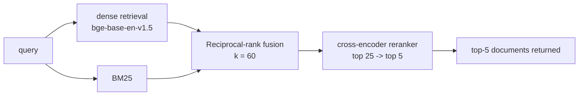
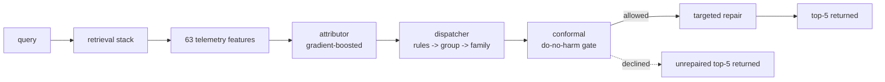

# DiagRAG: how it works, end to end (a speaker's guide)

Audience: you already know RAG and LLMs. This document explains the **mechanism** of every part of DiagRAG so you can present it, defend it, and answer hard questions.
Every number comes from a file in this repository (source given as `path`). Anything that is **illustrative** (a made-up example to explain an idea) is marked as such. Status date: **19 Nov 2026**. v11.a runs are launched but have **no results yet**; nothing from them is used here.

---

## 0. The whole project in 60 seconds

> A RAG system answers from documents it retrieves. When retrieval fails silently, the answer is wrong and nothing says why. **DiagRAG reads only the numbers the retrieval stage already produces (63 "telemetry" features per query), and from them it (1) detects that retrieval failed, (2) names which of 32 known fault types caused it, (3) applies a targeted repair, and (4) gives a statistical bound on how much it can hurt queries that were fine. It uses no generated answer and no LLM call at run time.**
>
> It is evaluated by **injecting** known faults into a retrieval pipeline, under **pre-registered pass/fail gates** and a hash of the exact code, on one main corpus (e-commerce) and four other corpora. It works well on detection and naming. It also has clear failures, and we report them.

If you only remember four sentences: **telemetry not LLM; diagnose then repair; conformal do-no-harm gate; failures reported as prominently as passes.**

**The point of the project (section 0b):** retrieval faults can be found and fixed *cheaply*, with a small model and rule-based repairs, **without any large LLM**, at higher closure than repairing everything and about one twelfth of its repair cost (in illustrative units; latency and dollars were not benchmarked).

---

## 0b. The point of the project: fixing retrieval faults cheaply, without a large LLM

This is the claim the whole project is built to test, so lead with it. **The claim:** a *small*, cheap model (a gradient-boosted classifier on 63 numbers the retrieval stage already produces) plus *rule-based repairs* can find and fix most retrieval faults, with **zero LLM calls at run time**, and without paying the cost of the obvious alternatives: (a) an LLM judging every query, or (b) blindly trying every repair on every query.

### What "cheap" means here, and how it is measured
There are **two different costs**. Keep them apart on stage.

| Cost | What is measured | Where it comes from |
|---|---|---|
| **LLM cost** | number of LLM calls and tokens per query | DiagRAG uses **0**. The LLM-based baselines use LLM calls on every query (see below). |
| **Repair cost** | "cost units" of the repairs a policy dispatches | an **illustrative** cost vector in the code: a Q-group repair = 1, K = 3, R = 8 (`kaggle/diagrag_v6.py`, comment: "illustrative cost vector of the original DiagRAG outline, not measured"). The diagnosis-free "universal" baseline applies the query-family repair (QLEX), then the K-group repair, then the R-group repair on every query = 1 + 3 + 8 = **12 units** (`universal()` in `kaggle/diagrag_v6.py`). |

### The measured evidence (held-out clean queries, same denominators; `docs/ALL_RUNS_MATRIX.md`)
| Policy | Clean loss | Clean dispatch | Mean cost (units) | Mean closure |
|---|---|---|---|---|
| **Diagnosis-free universal repair** (try everything on every query) | **1.48%** | 100% | **12.00** | 0.749 (v6 GPU), 0.756 (v8 GPU) |
| **DiagRAG capped policy** (`capped_crc_0.005`) | **0.12%** | 16.5% (v6), 15.5% (v8) | **0.93 (v6), 1.01 (v8)** | 0.834 (v6), 0.866 (v8) |
| DiagRAG stratified policy that gates L1 (`mondrian_crc_0.005`) | 0.28% (v6), 0.40% (v8) | 86% (v6), 91% (v8) | 3.65 (v6), 4.11 (v8) | 0.844 (v6), 0.886 (v8) |

**How to say it:** *diagnosing first* gets **higher closure** than repairing everything, at **about one twelfth of the repair cost** (0.93 or 1.01 units against 12.00) and **about one twelfth of the harm to healthy queries** (0.12% against 1.48% clean loss). That is the cheapness result: not "fewer repairs" for its own sake, but *the right repair, rarely, with a bounded harm guarantee*. The capped policy meets all four pre-registered targets (clean loss <= 0.5%, clean dispatch <= 25%, mean cost <= 1.5, closure >= 0.80) on both GPU runs.

### The LLM side of the cost claim
- A zero-shot LLM judge of the returned documents used about **587 tokens per item** (Gemini 3.1 Flash-Lite), 673 (gpt-oss-120b) and 658 (gpt-oss-20b), **one call per query**, and reached AUROC 0.63 to 0.75 against 0.975 for the telemetry attributor (`docs/LLM_BASELINES_RESULTS.md`).
- The CRAG-style repair used **1.15 LLM calls per query (about 517 tokens)**. On 1,000 natural queries, DiagRAG's loop minus the CRAG-style repair was **+1.23 points of Hit@5 [-0.10, +2.60]**: *non-inferior*, **not** better, at **zero** LLM calls.
- So the defensible statement is: **"comparable repair quality on natural traffic, better diagnosis on injected faults, and no LLM calls."**

### What is NOT shown (volunteer these before a reviewer asks)
1. **The repair cost units are illustrative, not measured.** No seconds, no dollars, no GPU-time was benchmarked for the telemetry, the classifier inference or the repairs. Some repairs are heavy (rebuilding the dense index view, re-embedding BM25 hits); the 1 / 3 / 8 weights are an assumption. The ranking "diagnose-first beats try-everything" would survive other weights only if the group costs stay in that order; that robustness was **not** tested.
2. **No dollar comparison against a frontier LLM.** Only free-tier models were tested; the planned cost-per-item comparison against a frontier model was not run (no funded key). "Without any extensive LLM" is therefore shown against *small free-tier* judges, not against the strongest models.
3. **Not every fault is fixed cheaply.** Q03 (synonym swap) is invisible to telemetry, and several faults (K06, Q03, Q07, Q09, Q02) have no effective repair on unseen faults; U1 closure is 0.40 against a 0.50 bar. For those, an LLM rewrite might help, and that was **not** tested beyond the reduced CRAG-style baseline.
4. **The cheap policy does not repair most natural failures.** Most natural failures are corpus-data problems (an empty placeholder gold document), and the natural-traffic gain (+2.1 to +2.4 points) comes almost entirely from two simple rules (K12, K05).
5. **"Diagnosis-free universal" is one specific strawman** (QLEX, K-group and R-group repairs applied in sequence to every query). It is the right reference for the cost question, but it is not the strongest non-LLM baseline one could build.

### One-line version for a slide
> *Diagnose from retrieval telemetry, repair with a rule, and bound the harm: higher closure than "repair everything" at about 1/12 of the repair cost and 1/12 of the clean-query damage, with zero LLM calls. Cost is in illustrative units; latency and dollars are not benchmarked.*

---

## 1. The problem

### 1.1 Why retrieval failures are "silent"
In RAG, the generator writes fluent text from whatever it was given. If the top-5 documents are wrong, the answer is still confident. Nothing in the output says "retrieval missed". The cause can be anywhere upstream:

| Where it breaks | Example |
|---|---|
| The query | a typo, a missing space, a chatty paragraph around a short need |
| The knowledge base | near-duplicate documents crowd out the right one; another tenant's documents leak in; placeholders with no content |
| The retrieval stack | a stale vector index, an encoder truncating input, a reranker returning garbage, approximate-search recall set too low, a misconfigured fusion |

### 1.2 Why not "just ask an LLM to judge every query"
An LLM judge costs money and latency on **every** query, and it sees only what a user sees (the query and the returned documents). Many faults leave no visible trace in the text of the top-5, but **do** leave a trace in the retrieval **telemetry**: score gaps, disagreement between the dense and keyword legs, duplicate counts, probes. That is the bet of the paper.

### 1.3 Detection vs diagnosis
- **Detection**: "did retrieval fail?" (one yes/no score).
- **Diagnosis**: "*which* fault caused it?" so a *targeted* repair can run. This is the contribution; plain detection is easier and is not the claim.

### 1.4 What the project is NOT claiming
- Not that it works on any production RAG system. The faults are **injected** by the authors on specific pipelines.
- Not that it replaces generation-time checks (it never looks at the generated answer).
- Not that it beats the full RAGLog or CRAG systems. Reduced, narrower versions of those ideas were compared (section 9).

---

## 2. The retrieval stack under test

- **Dense** (bge-base-en-v1.5) and **BM25** (k1 0.9, b 0.4) are fused with **reciprocal-rank fusion** (k = 60). The top **25** go to a **cross-encoder reranker** (bge-reranker-large on GPU, MiniLM-L6 on CPU). The **top 5** are returned.
- A **tenant filter** and a **validity-date filter** are on by default (to model multi-tenant and versioned documents).
- **Success = Hit@5**: a gold (correct) document is in the top 5. Identity-sensitive faults (Q07, K03, K06, K07, K09) need the gold at **rank 1**.
- **Corpus:** 101,297 documents after removing 84,993 of the original 186,290 whose licence status was unverified (`PROJECT_EXPLAINED.md` section 3). Sources: Amazon ESCI (Apache-2.0), Amazon Berkeley Objects rows with a verified CC BY 4.0 licence, an Apache OFBiz manual, and a synthetic "ShopNova" partition (tenants, policies, product codes; its licence is still unassigned).

---

## 3. The fault model: 32 injectable faults

A **fault** is something we deliberately break, in a controlled way, so the right answer (which fault) is known.

- Four groups: **Q** (query), **K** (knowledge base), **R** (retrieval stack), **C** (composition: two faults at once).
- **Core 28** = 7 Q + 7 K + 13 R + C2. The adoption rule counts these. Four more (R25, R26, K11, K12) come from field reports and are reported alongside. Total **32** (`docs/CORE28_FAULTS.md`).
- Each fault carries an **evidence tier** linking it to public reports: S and M (22 faults) are "grounded"; N and P are "quarantined" (reported, excluded from headline claims).

### 3.1 Examples (what the fault does, how it is detected, how it is repaired)

| Fault | What is injected | Detected by | Repair |
|---|---|---|---|
| **Q01** | unfinished last word ("nike fleece sho") | a head on query features | autocomplete from a query log (the log excludes every base query, so nothing leaks) |
| **Q04** | real misspellings (Webis-QSpell-17) | a **precise rule**: a token has a corpus spelling correction | SymSpell-style correction from corpus words |
| **Q05** | missing space ("screenprotector") | a head on out-of-vocabulary and segmentable tokens | dynamic-programming word segmentation |
| **K04** | the gold document's dense vector is **stale** (replaced by another document's vector) | an index-health probe: re-embed the BM25 top-20 and compare with the served vectors | re-embed BM25 hits missing from the dense list, correct the stale vectors, re-fuse |
| **K05** | 7 near-copies of the strongest competing document | redundancy features (`dup5`, `red_cos5`, `ident5`) | collapse near-duplicates (shingle Jaccard >= 0.8 or cosine >= 0.985), refill |
| **K07** | tenant filter off; other-tenant versions of FAQ and policy documents | a **precise rule**: a returned document is outside the query's tenant | re-apply the tenant filter |
| **R01** | 30% of the dense index missing, gold included | coverage and "sparse hit absent from dense" features | rebuild the dense view from the verified cache |
| **R05** | reranker returns garbage scores | rank correlation between the reranker and fusion order | swap to a fresh reranker; fall back to the fused order |
| **R15** | approximate-nearest-neighbour recall too low (`nprobe`=1) | a **precise rule**: ANN top-10 vs exact top-10 recall < 0.9 | raise `nprobe` (32, 128), then exact search |
| **R22** | raw-score fusion instead of RRF (BM25 scale swamps cosine) | a head on score statistics | restore RRF |
| **R23** | partial results after a timeout (1 to 2 documents) | a **precise rule**: fewer than 5 results | retry for full results |

**Rule-based vs learned detectors.** Seven faults (Q04, K07, R15, R23, R25, R26, K11) have a precise rule on one probe. The rest use a **gradient-boosted head** on the telemetry.

**Shared repairs ("families").** Faults whose cause is nearly the same share a repair: **QLEX** for Q01, Q03, Q04, Q05; **STALE** for K04, R07; **ENC** for R03, R10, R11. Confusing faults inside a family is counted as correct, because the same repair fixes them.

---

## 4. How an evaluation episode is built (the part reviewers question first)

An **episode** is one query run through the clean pipeline and through the faulted pipeline.

**The hard-episode rule:** an episode is kept **only if the clean pipeline succeeds and the faulted one fails.** So every kept episode has something real to repair, and "the baseline was already right" cannot inflate results. The yield (how many injections were easy, not applicable, or hard) is reported per fault.

- **Train/test split by gold-product component** (union-find over shared gold products, then hashed): no gold product appears on both sides. The code asserts zero leakage.
- **Clean episodes** (no fault) are included, so the model must also learn "nothing wrong".
- Each fault aims for 50 held-out positives (the v6 main runs reach about 50). The BEIR port runs have **25** held-out positives per fault.

---

## 5. Telemetry: the 63 numbers per query

Computed **only from the retrieval trace**: no gold label, no generated answer. Groups (`paper/diagrag_ieee.tex`, Telemetry):

| Group | Examples (feature names from the repo) |
|---|---|
| Query | length, out-of-vocabulary rate (`q_oov`), correctable tokens, segmentable tokens (`q_segmentable`), IDF statistics |
| Score statistics | dense gap, sparse gap, cross-encoder gap (`s_gap`, `d_gap`, `ce_gap`) |
| Agreement between legs | rank correlation of reranker and fusion (`ce_rrf_rho`), "sparse hit absent from dense" |
| Duplicates and crowding | `dup5`, `red_cos5`, `ident5` |
| Tenant and validity | `tenant_mis5`, `expired5`, `unver5` |
| Cheap probes | ANN-vs-exact recall (`ann_probe`), vector alignment (`align_probe`), stale-vector probe (`stale_sparse20`, `stale_min`) |

**Intuition:** a healthy query has a clear top-1 over the rest, dense and keyword legs mostly agree, no duplicates crowd the list, and probes say the index is healthy. Each fault bends a *different* subset of these. That is why a classifier can tell faults apart.

> Illustrative (not a measurement): a stale-vector fault makes the keyword leg find a document that the dense leg does not list, and a re-embedding probe disagrees with the served vector. A reranker-garbage fault instead destroys the rank agreement between reranker and fusion.

---

## 6. The closed loop, step by step

### 6.1 Attributor
A **histogram gradient-boosted classifier** (250 iterations, learning rate 0.08, 15 leaves, L2 1.0, balanced class weights). It maps 63 numbers to a probability over classes: **clean (NONE) plus each fault**. C2 (a composition) is never a training class. **Supervised**: trained on labelled episodes from the training split.

### 6.2 Dispatcher (how a probability becomes a repair)
1. If a **precise rule** fired (for the seven rule-based faults), use it first.
2. Otherwise choose the **letter group** (Q, K or R) by total probability mass.
3. Inside the group choose the **repair family** (QLEX, STALE, ENC, or a single fault). If no family is clearly ahead (threshold **tau = 0.6**), fall back to the **group repair**.
4. A **second label** from another group is returned when that group's mass is high enough (this is the only way it ever names two faults).

This family-first design is what lets it repair when it is unsure *which* of two similar faults it is, because both share a repair.

### 6.3 Repairs
One repair per fault, plus family repairs and group fallbacks (examples in section 3.1). **A repair passes its gate** if its rescue rate has a **Wilson 95% lower bound >= 0.50** and it **loses at most 10% of clean successes** when forced onto clean queries.

### 6.4 The do-no-harm gate (conformal risk control)
The risk: dispatching a repair on a query that was fine can **hurt** it. The gate controls that.

- Let `loss(lambda)` = the Hit@5 **lost** on a clean query when repairs are dispatched whenever the attributor's fault probability exceeds `lambda`.
- `loss` is **monotone** in `lambda` (a higher threshold dispatches less, so it can only lose less).
- **Conformal risk control** picks the smallest `lambda` whose calibrated expected loss is at most **alpha = 0.005** (0.5%).
- Calibration is done **separately in three strata** (common ESCI queries, rare ESCI queries, the ShopNova partition). This is a **Mondrian** guarantee: the bound holds per stratum.
- **Capped variant:** raise `lambda` further until clean classifier dispatch is at most 20% on the calibration set. The loss bound survives because the loss is monotone.

**What to say about the guarantee (and its honest limit):** the bound is statistical and rests on the usual conformal assumption that calibration and deployment queries are exchangeable (general property of conformal methods, not a finding of this repo). In this project it is verified empirically on **held-out clean episodes**: held-out clean loss 0.28% (v6 GPU), 0.40% (v8 GPU), against a bar of 0.5%.

---

## 7. The pass/fail gates ("what counts as success"), and why they are pre-registered

| Gate | Meaning | Bar |
|---|---|---|
| **Detector** | held-out one-vs-rest AUROC for a fault | >= 0.70 with >= 50 held-out positives (else "THIN") |
| **Repair** | rescue-rate Wilson lower bound; clean loss | >= 0.50; <= 10% |
| **L1** | held-out clean loss of the deployed policy | <= 0.5% |
| **L2** | mean closure on injected faults | >= 0.70 |
| **U1** | mean closure on faults the attributor **never saw** (leave-one-fault-out) | >= 0.50 |
| **N1** | gain on **natural traffic** (1,648 never-examined real queries, no injection); 95% interval must exclude zero | > 0 |
| **Adoption** | a run is ADOPTED if >= 27 of 28 core detectors and >= 24 of 28 repairs pass | |

**Closure** = the share of episodes where the gold document is back in the top-k after the loop.

**Pre-registration discipline (this is a selling point; say it plainly):**
- Before each judged run, a **protocol file** records the gates, the configuration, and the **SHA-256 of the exact code** (and library versions from v5).
- Amendments are **dated and committed before** the result they touch.
- **Failed runs stay in the table.** One run per configuration; no seed shopping.
- Verified mechanically by `docs/evidence/v9_verify.py`, `v11_verify.py`, and `check_v7_hash_trail.py`.

---

## 8. Results (with the run each comes from)

### 8.1 Every judged run (`docs/ALL_RUNS_MATRIX.md`)
Runs seed 42 to 50 and 52. Adopted: 42, 43, 44, 45, 46, 47, 50 (GPU), 50 (CPU replication), 50 (v7 regression). **Not adopted: seed 48 (v4 GPU, 26 of 28 detectors), seed 49 (v5 CPU, 24 of 28), seed 52 (v6 code, GPU, fresh seed: 26 of 28).**

### 8.2 The headline v6 GPU flagship (seed 50)
- **ADOPTED**: 27 of 28 core detectors, 27 of 28 repairs. Only **Q03** is unsolved.
- Held-out clean loss **0.28%** (L1 pass); L2 mean closure **0.844** (pass); N1 natural gain **+2.18 Hit@5 points [+1.33, +3.03]** (pass); **U1 = 0.406 (FAIL, bar 0.50)**.
- Fault-vs-clean detection AUROC **0.9746 [0.970, 0.980]**.
- Exact fault named on **89.7%** of held-out faulted episodes (n = 1,510) on GPU (89.9% on the CPU run; `docs/evidence/diagnosis_confusion_v6*.json`). Bootstrap over training resamples: about **88 to 90%**, so quote a range, not a point.

### 8.3 The v8 result you must be ready to explain
The **same frozen code**, same settings, fresh seed 52 on GPU, is **NOT_ADOPTED (26 of 28)**. The two missing detectors: **Q03** (0.618, also failed in v6) and **C2** (0.681 [0.579, 0.786]; passed at 0.751 in v6). The C2 change is within sampling noise (z = 0.98, p about 0.33; 50 held-out positives give about +/-0.10 intervals). Everything else is stable (detection AUROC 0.973, repairs 27, L1/L2/N1 pass, U1 0.397).
**How to say it:** "adopted at seed 50, not at seed 52; a detector sitting near the 0.70 bar cannot be classified reliably with 50 positives." A descriptive analysis (`docs/evidence/v10_adoption_intervals.md`) shows the 27-of-28 verdict depends on a detector whose interval contains 0.70 in 5 of 12 judged runs.

### 8.4 Diagnosis against baselines (ESCI, held-out episodes)
| Method | Fault-vs-clean AUROC |
|---|---|
| **DiagRAG attributor** (supervised, telemetry) | **0.975** |
| RAGLog tier-0 features + same classifier | 0.735 |
| Query-performance predictors (NQC, WIG, negated reranker score) | 0.57 to 0.62 |
| Zero-shot LLM judges (Gemini 3.1 Flash-Lite 0.754; gpt-oss-120b 0.701; gpt-oss-20b 0.629) | 0.63 to 0.75 |
**Fairness caveat you must volunteer:** the attributor is *supervised* and the LLM judges are *zero-shot*, on free-tier models; no frontier model was tested.

### 8.5 Natural traffic (no injection)
1,648 real queries no earlier run had examined. The deployed loop gains about **+2.1 to +2.4 Hit@5 points** across runs, **almost all from two simple rules (K12, K05)**. That is the honest reading: the classifier adds little on natural traffic. Also: most natural failures are **corpus-data problems** (the gold document is an empty placeholder for 58.6% of queries), which no repair can fix (`PROJECT_EXPLAINED.md` section 1).

### 8.6 Unseen faults (U1) and identifiability
- Closure on a fault the attributor never saw: **0.395 to 0.485 across runs; never reached 0.50** (v6: 0.406; v8: 0.397).
- Why: group attribution on unseen faults is right only 40 to 58% of the time, and several faults (K06, Q03, Q07, Q09, Q02) have no effective repair.
- **Q03 (synonym swap) is essentially invisible to telemetry:** the attributor calls 96% of held-out Q03 episodes clean, in both v6 and v8, exact identification 0 of 50 (`docs/evidence/V10_DIAGNOSIS.md`). A synonym swap barely changes retrieval telemetry; the repo's own identifiability analysis flagged it in advance. This is a *limit of the signal*, not a tuning problem.

### 8.7 Composed faults (v7: two or three faults at once)
- 155 held-out synthetic composed episodes (one seed, CPU). Every cause named: **40.0% [32.6, 47.9]** (single-fault attributor: 30.3%).
- It is **two different numbers**: **0 of 75** for pairs inside one letter group and for triples (by construction: the dispatcher returns at most one label per group); **80 to 85%** for the cross-letter pairs QR and KR (45% for QK).
- Sequential repair closed **72.9%** vs **83.9%** when the true causes are repaired in order.
- **Emergent failures:** 40 of 155 composed episodes fail although **no single component fails alone**; they are named about as often (37.5%) as the others (post-hoc, `v9_emergent_breakdown_v7.json`).
- **Post-hoc multi-label rule** (`docs/evidence/v10_multilabel_protocol.md`): naming rises to **75.5% [68, 82]** at precision 0.99, **but 14.6% of clean episodes then receive a label (vs 4.7%)**, and 4.2% of single-fault episodes get a wrong label (vs 0.9%). Naming only; no repair claim. Present it as a trade-off, not a win.

### 8.8 Other corpora (the "port" arm)
Same 20 faults, same gates, a second stack (e5-small-v2 + FAISS HNSW + BM25 + MiniLM reranker). "Ports" means >= 15 of 20 solved.

| Corpus | Clean Hit@5 | Solved (of 20) | Unsolved |
|---|---|---|---|
| SciFact | 0.804 | 15 | Q01, Q03, K04, R15, R22 |
| FiQA | 0.535 | 19 | K04 |
| NFCorpus | 0.665 | 19 | K04 |
| ArguAna | 0.558 | 18 | Q01, Q03 (not trainable: too few applicable queries) |
Cautions: 11 to 16 trained detectors per corpus sit at AUROC >= 0.995, so these faults are blunt; one stack; 25 held-out positives per fault; 20 of the 32 faults. SCIDOCS (v11.a) is running and has no result yet.

### 8.9 A fair supervised text baseline
Trained on the same labelled episodes, seeing the query and the top-5 text: AUROC **0.575 (NFCorpus) and 0.596 (ArguAna)** against **0.972 and 0.996** for telemetry; exact-fault accuracy about 10% vs 85% and 7% vs 98%. Limits: a simple TF-IDF model with about 25 positives per fault; a fine-tuned cross-encoder or an LLM with labelled examples is **not tested**. Likely reason for the gap (explanation, not tested): telemetry carries quantities (score gaps, leg agreement, probes) that are not in the top-5 text.

### 8.10 Simulated quantum ML (side note)
Six-qubit simulated models reach 0.892 (kernel) and 0.883 (variational) AUROC vs 0.978 for gradient boosting on all 63 features. **No quantum advantage; none is claimed.** Mention only if asked.

### 8.11 Benchmark
DiagRAG-Bench v1.0: 2,718 dev episodes (public labels) and 2,125 test episodes (labels private, committed by hash). Reference diagnoser test AUROC 0.976. **Staged, not released** (the ShopNova licence is unassigned).

---

## 9. Baselines, and exactly how narrow they are
- **RAGLog-style (B1):** an LLM sees the query and the five returned documents and returns P(failed) and a cause group. **Not** the full RAGLog (no generated answer, no multi-stage logs, no trained classifier over LLM checks).
- **CRAG-style (B2):** an LLM grades the five documents; if none is relevant it rewrites the query and retrieval runs again. **Not** the CRAG paper (no web search, no fine-tuned evaluator). On 1,000 natural queries with Gemini: loop minus CRAG-style repair **+1.23 points [-0.10, +2.60]**, verdict *non-inferior*, not *better*; the two Groq arms are inconclusive on 300 queries.
- The LLM baselines cost LLM calls on every query; DiagRAG uses **zero** at run time.

---

## 10. What failed (say this before you are asked)
1. **Adoption is not robust to the seed** (v6 adopted at seed 50; same code not adopted at seed 52). Earlier, v4 on GPU and v5 on CPU also missed it; v6 adopted only after a construction fix (6,000 base queries, balanced C2 pair mix).
2. **U1 never reached 0.50** (best 0.485).
3. **Q03** is not detectable from this telemetry; **C2** sits near the bar.
4. Repairing **natural misspellings** does not help (negative point estimate in every run that measured it).
5. **The dispatcher cannot name two faults of one group**; the multi-label rule buys naming at the price of false labels.
6. **No frontier-LLM comparison**; no full-suite second corpus (ports cover 20 of 32 faults); the benchmark is not released.
7. The **label-permutation control** missed its pre-registered band in both audits (mean about 0.53 vs band 0.45 to 0.55). The post-hoc explanation is covariate shift (a label-free distance score already separates faulted from clean at AUROC 0.72). It is an explanation, not proof of no leakage.
8. **Faults are injected by the authors**, the main evidence is **one corpus**, and the code was **written by an AI assistant under the owner's direction** (disclose this).

---

## 11. Threats to validity (the honest list)
- **Internal validity:** injected faults are by construction something the detectors were designed for; many port detectors are at the AUROC ceiling (blunt faults). A pass shows the method works on this construction, not on any production system.
- **External validity:** one e-commerce domain for the main claims; four BEIR corpora for ports on one second stack.
- **Statistical:** 50 (main) or 25 (ports) held-out positives per fault give wide intervals; thresholds at the 0.70 bar can flip between seeds.
- **Reproducibility:** verdicts decided by 0.001 to 0.005 are sensitive to the scikit-learn version (re-fits under the recorded versions reproduce all recorded AUROCs, 31 of 31; other versions can move near-bar detectors by up to 0.03).
- **Natural-traffic sample is the same 1,648 queries in every main run**, so repeated N1 numbers are re-measurements, not independent samples.

---

## 12. Likely questions and honest answers

**Q: Why not use an LLM to judge?** Cost and latency on every query; and on this task a zero-shot judge got AUROC 0.63 to 0.75 vs 0.975 for telemetry. *Fairness:* the comparison is supervised vs zero-shot, free-tier models only.

**Q: Aren't you just detecting faults you injected yourselves?** Yes, partly. That is the main limitation. Mitigations: faults carry public evidence tiers; the natural-traffic arm uses real queries with no injection (gain +2.1 to +2.4 points, mostly from two simple rules); four other corpora. It does not prove field validity.

**Q: Your adoption verdict flipped with the seed. Why believe it?** Believe the stable parts (detection AUROC about 0.973, 27 of 27 repairs, L1/L2/N1 pass) and not the single 27-of-28 count: with 50 positives a detector near the bar cannot be classified reliably. We report both seeds and an interval analysis.

**Q: How is the guarantee valid?** Conformal risk control with a monotone loss, per stratum (Mondrian), calibrated on clean queries; verified on held-out clean episodes (0.28%, 0.40% vs 0.5%). Standard exchangeability assumption applies.

**Q: Why does Q03 fail?** A synonym swap barely changes retrieval telemetry; 96% of its held-out episodes look clean to the attributor; the identifiability analysis predicted it.

**Q: What would convince you it generalises?** More corpora with subtler faults, real field failures, a frontier-LLM comparison, and independent replication. We do not have the last three.

**Q: Is the code reproducible?** Frozen code hashes, a protocol per run, `v9_verify.py` / `v11_verify.py`, and exact input hashes (`kaggle/judged_v9/INPUTS_MANIFEST.json`). The scripts do not pin model revisions or library versions beyond what the manifest records.

---

## 13. Suggested talk structure (20 minutes)

| # | Slide | Time | Key message |
|---|---|---|---|
| 1 | Silent retrieval failure | 2 min | cause is upstream; generator hides it |
| 2 | Idea: telemetry, not LLM | 1.5 | 63 numbers; no answer, no LLM call |
| 2b | **The cheapness claim** (section 0b) | 2 | diagnose-first beats try-everything: closure up, repair cost about 1/12, clean harm about 1/12; units illustrative |
| 3 | The 32 faults (Q, K, R, C) | 2 | grounded in field reports; evidence tiers |
| 4 | Episodes and the hard-episode rule | 1.5 | clean succeeds and faulted fails; no leakage |
| 5 | The loop (figure) | 3 | attributor -> dispatcher -> gate -> repair |
| 6 | Do-no-harm gate | 2 | conformal risk control, per stratum, alpha 0.5% |
| 7 | Pre-registration | 1 | hashes, gates, amendments, failures kept |
| 8 | Results: diagnosis and baselines | 2 | 0.975 vs 0.735 vs 0.63 to 0.75 (with the fairness caveat) |
| 9 | Results: natural traffic and ports | 1.5 | +2.1 to +2.4 points; 15 to 19 of 20 on four corpora |
| 10 | Where it stops | 1.5 | composed faults, Q03, U1, seed-dependent adoption |
| 11 | Threats and take-aways | 1.5 | what is and is not shown |

**Take-aways to end on:** (1) telemetry carries enough signal to name most retrieval faults without an LLM; (2) a conformal gate bounds harm to healthy queries; (3) pre-registered, failure-inclusive evaluation is a methodology other fault-diagnosis papers can reuse; (4) the open problems (unseen faults, subtle faults, field validity) are stated, not hidden.

---

## 14. Phrases to avoid
- Do **not** call 0.975 "accuracy" (it is an AUROC). Exact-fault accuracy is a different number (about 88 to 90%).
- Do **not** say "adopted on GPU and CPU" without adding "and not adopted at a fresh seed".
- Do **not** say "beats RAGLog" or "beats CRAG": say "RAGLog-style" and "CRAG-style".
- Do **not** present the multi-label 75.5% without the false-label cost.
- Do **not** present the QML result as an advantage.
- Do **not** quote results from v11.a until they exist.

---

## 15. Glossary
- **Telemetry:** numbers produced by the retrieval stage for one query (scores, ranks, counts, probes).
- **Episode:** a query run clean and faulted; kept only if clean succeeds and faulted fails.
- **Attributor:** the classifier mapping telemetry to {clean, fault}.
- **Dispatcher:** turns attributor probabilities into a repair (rule -> group -> family -> fallback).
- **Closure:** share of episodes where the gold document is back in the top-k after repair.
- **Hit@5:** a gold document is in the top 5.
- **AUROC:** probability a random faulted episode scores higher than a random clean one; 0.5 is chance.
- **Wilson interval:** a confidence interval for a proportion that behaves well at small n.
- **Conformal risk control:** a method that picks a threshold so an expected, monotone loss is bounded on calibration data.
- **Mondrian calibration:** doing the calibration separately in each stratum.
- **THIN:** fewer held-out positives than the gate requires; counts as not solved.
- **Pre-registration:** gates, configuration and code hash written before the run.

---

## 16. Where to find things

| What | Path |
|---|---|
| Paper source | `paper/diagrag_ieee.tex` |
| Full project explainer | `PROJECT_EXPLAINED.md`, `A_TO_Z_GUIDE.md` |
| Fault catalogue | `docs/CORE28_FAULTS.md` |
| Every judged run | `docs/ALL_RUNS_MATRIX.md` |
| Main pipeline (frozen) | `kaggle/diagrag_v6.py` |
| Port arm (frozen) | `kaggle/diagrag_port2.py` (and port3, port4) |
| Protocols | `docs/evidence/v6_protocol.md`, `v7_composed_protocol.md`, `v8_protocol.md`, `v9_protocol.md`, `v11_protocol.md`, `v11b_protocol.md` |
| Audits and diagnoses | `docs/evidence/v8_audit.py`, `V10_DIAGNOSIS.md`, `v10_adoption_intervals.md` |
| A-to-Z generated report | `kaggle/judged_v11a/REPORT_V11A.md` (fills in when v11.a finishes) |
| LLM baselines | `bench/llm_baselines.py`, `docs/LLM_BASELINES_RESULTS.md` |
